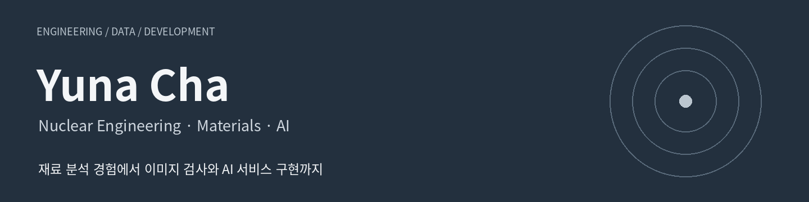
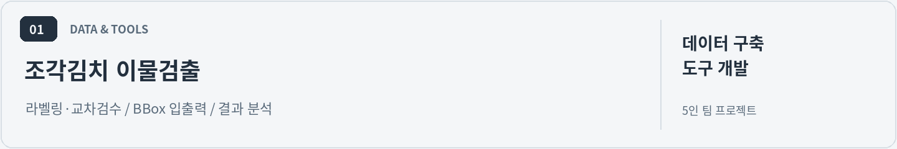
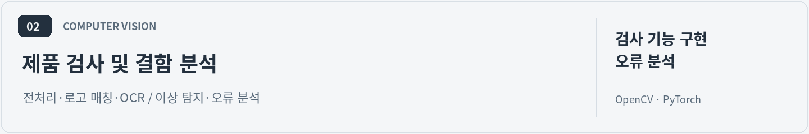
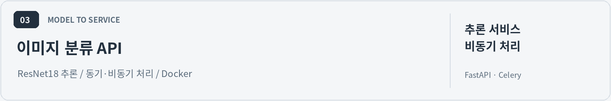
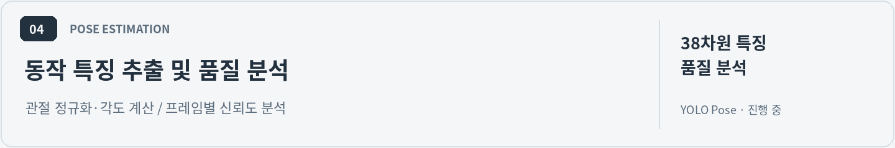

## 👋 About Me

원자력공학을 전공하고 재료 분석 실험과 분자동역학 시뮬레이션을 수행했습니다.
Python 기반 이미지 검사, AI 추론 API, 영상의 동작 특징 추출 프로젝트를 진행했습니다.
재료와 설비의 상태를 분석하는 데 전공 지식과 AI 기술을 함께 활용하고자 합니다.

## 🗂️ Projects

카드를 누르면 관련 저장소로 이동합니다. 아래 프로젝트는 교육 과정에서 수행한 작업입니다.

📋 역할과 작업 내용 자세히 보기

### 🥬 조각김치 이물검출을 위한 데이터 구축 및 검수 도구 개발

5인 팀으로 조각김치 이물검출용 이미지 900장의 라벨링 작업을 진행했습니다. 이미지 라벨링과 교차검수로 학습 데이터 구축에 기여하고, Claude를 활용해 BBox 데이터 관리·파일 입출력 기능을 개발했습니다. 팀의 모델 학습 결과를 분석하고 발표자료로 정리했습니다.

| 구분 | 내용 |
|---|---|
| 라벨링·검수 | 담당 이미지 200장 라벨링, 팀 내 교차검수 참여 |
| 도구 개발 | Claude를 활용한 BBox 데이터·파일 입출력 파트 개발 |
| 담당 범위 | BBox 모델·관리, YOLO 입출력, 파일 동작, 이미지 탐색·썸네일 관련 모듈 |
| 결과 정리 | 팀의 모델 학습 결과 분석, 발표용 PPT 작성 |
| 팀 역할 분담 | 다른 팀원은 모델 학습을, 저는 데이터 작업·담당 도구 기능·학습 결과 분석을 수행 |

[팀 저장소](https://github.com/Jihoo2/G5_kimchi)

---

📋 역할과 작업 내용 자세히 보기

### 🔍 머신비전 기반 제품 검사 및 결함 분석

OpenCV 기반 제품 검사 기능을 구현하고, 전처리·로고 매칭·OCR·ResNet18 기반 이상 탐지 방법을 비교했습니다. 검사 영역 설정부터 판정 기준 수립, 오류 분석까지 단계별 실험 결과를 정리했습니다.

정상 제품의 오검출과 작은 파손의 미검출 원인을 분석했습니다. 전역 특징과 위치별 특징을 결합한 판정 방식도 비교했으며, 조명 변화와 전처리가 검사 결과에 미치는 영향을 확인했습니다.

- **작업:** ROI, 전처리, SIFT·Homography, OCR, 이상 탐지
- **분석:** 정상 이미지의 오검출, 작은 파손 미검출, 조명 변화의 영향
- **한계:** 기존 Test 실패를 보고 수정한 이상 탐지 방식은 별도 미사용 데이터로 재검증이 필요합니다.

[코드와 실험 기록](https://github.com/yunacha0105/ai_vision)

---

📋 역할과 작업 내용 자세히 보기

### ⚙️ ResNet18 기반 이미지 분류 API 구현

ResNet18 이미지 분류 모델을 FastAPI에 연결해 웹·API 기반 추론 기능을 구현했습니다. 동기 요청과 Redis·Celery를 사용하는 비동기 작업 처리를 구성하고, Docker 기반 실행 환경을 마련했습니다.

- **구성:** FastAPI, Redis, Celery, Docker
- **확인할 점:** 요청을 접수하는 시간과 최종 추론 결과를 받는 시간은 구분해서 비교해야 합니다.

[프로젝트 저장소](https://github.com/yunacha0105/fastapi_resnet18)

---

📋 역할과 작업 내용 자세히 보기

### 🏃 YOLO Pose 기반 동작 특징 추출 및 품질 분석 · 진행 중

YOLO Pose의 COCO 17개 관절 정보를 활용해 영상의 프레임별 동작 특징 추출 과정을 구현했습니다. 골반 중심·어깨 폭을 기준으로 좌표를 정규화하고, 좌표 34개와 팔꿈치·무릎 각도 4개를 결합해 38차원 특징을 생성했습니다.

점프 스쿼트 영상에서 무릎 각도의 변화를 확인하고, 특징 계산에 사용한 관절의 Confidence를 함께 살펴봤습니다. 특징이 계산되더라도 모든 관절이 정확히 검출됐다는 뜻은 아니므로, 계산 성공 여부와 검출 품질을 나눠 기록했습니다.

[코드와 분석 기록](https://github.com/yunacha0105/subject10)

## 🛠️ Tools & Background

| 분야 | 사용 경험 |
|---|---|
| 이미지·데이터 | Python · OpenCV · PyTorch · YOLO Pose |
| API·실행 환경 | FastAPI · Redis · Celery · Docker |
| 재료 분석 | OM · SEM · EDS · 비커스 경도 |
| 시뮬레이션 | LAMMPS · Atomsk · OVITO |

SCK CEN 재료 연구 인턴으로 철 기반 합금의 조직·성분·경도를 분석했습니다.
졸업논문에서는 원자로 압력용기강을 모사한 합금의 초기 조사 결함과 인장 특성을 분자동역학으로 분석했습니다.
